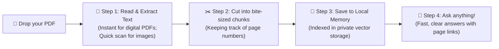

# 🔬 PaperScope — Project Summary (Simple & Clear Guide)

> **PaperScope** is a private, completely offline assistant that helps you read, understand, and question research papers. 
> It opens a research paper PDF on one side of your screen and gives you a helpful AI chat on the other side. Everything runs **100% locally on your computer** — no internet connection required, zero cloud subscriptions, and zero leaks of your private documents.

---

## 📌 Table of Contents
1. [What is PaperScope?](#1-what-is-paperscope)
2. [Why Use PaperScope?](#2-why-use-paperscope)
3. [How It Works (In Simple Terms)](#3-how-it-works-in-simple-terms)
4. [Cool Things You Can Do](#4-cool-things-you-can-do)
5. [How It Runs Fast on Your Computer](#5-how-it-runs-fast-on-your-computer)
6. [Buttons & Features Guide](#6-buttons--features-guide)
7. [How to Start the App](#7-how-to-start-the-app)
8. [Folder Structure](#8-folder-structure)

---

## 1. What is PaperScope?

When researchers, students, or engineers read complex academic papers, it can take hours to digest dense math, track down specific facts, or double-check claims.

**PaperScope solves this by giving you a smart reading partner:**
- **Split-Screen View**: The PDF is on the left; the AI assistant is on the right.
- **Clickable Citations**: When the AI answers your question, it highlights the exact sentence on the exact page of the PDF with a gold box so you can verify it yourself.
- **100% Private & Offline**: No cloud APIs (no OpenAI, no Google Gemini, no Ollama). Your documents never leave your computer.

---

## 2. Why Use PaperScope?

| What Most People Deal With | How PaperScope Makes It Better |
| :--- | :--- |
| **Uploading papers to ChatGPT / Claude** risks leaking secret research, medical data, or draft patents to the cloud. | **100% Offline**: Your PDF stays securely in your computer's RAM and disk. |
| **AI models make things up (hallucinations)** and cite non-existent papers. | **Direct Proof**: Every answer points directly to page numbers and quoted excerpts. |
| **Struggling through complex math formulas** and notation walls. | **Equation Dissector**: Breaks down every variable and explains what it means in plain English. |
| **Traditional PDF readers are dumb** and can't explain or summarize anything. | **Instant Summaries & Voice**: Read or listen to easy audio briefings right inside the app. |

---

## 3. How It Works (In Simple Terms)

Here is what happens when you drop a paper into PaperScope:



1. **Upload**: You drag and drop a PDF file.
2. **Text Reading**: It quickly extracts the text. If the paper is an older scanned document, it runs a quick built-in reader (OCR) to read the scanned pages.
3. **Chunking**: It breaks the text into small pieces while noting which page each piece came from.
4. **Smart Search**: When you ask a question, it finds the most relevant paragraphs from the paper.
5. **Clear Answer**: The local AI reads those paragraphs and writes a clean, easy-to-understand explanation with clickable page buttons.

---

## 4. Cool Things You Can Do

### 📄 1. Ask Any Question
Ask things like:
- *"What problem is this paper trying to solve?"*
- *"What were the final test results?"*
- *"What datasets did the authors use?"*

### ⚡ 2. One-Click Executive Summary
Click the **"Executive Summary"** button to instantly get:
- The core problem
- How they solved it
- Key findings and numbers
- The main takeaway

### 🎯 3. Live Page Highlighting
Whenever the AI mentions a finding, you can click the citation pill (e.g., `Page 4`). The PDF automatically flips to page 4 and puts a golden highlight box over the exact sentence.

### 🥊 4. Reviewer #2 Critical Audit
Want to know where the paper might be weak or misleading? Click **"Reviewer #2"**. It acts like a tough academic reviewer and points out questionable assumptions, missing tests, and questions to ask the authors.

### 📐 5. Math & Formula Breakdown
Copy and paste a scary formula or click **"Dissect Math"**. PaperScope explains what each symbol ($x$, $\theta$, $\lambda$, $\mathbb{E}$) stands for and why it matters in simple English.

### ⚖️ 6. Compare Two Papers
Load multiple papers and compare them side-by-side to see which method was faster, which had better accuracy, and the pros and cons of each.

### 🎧 7. Natural Voice Briefing
Tired of reading? Click the speaker icon to have PaperScope read the explanation aloud to you using your computer's built-in natural voice.

### 📥 8. Download Clean PDF Notes
Click the download button to export a nicely formatted A4 PDF containing your entire research chat, complete with summaries, answers, and page sources.

---

## 5. How It Runs Fast on Your Computer

You don't need a supercomputer or a giant server to run PaperScope:

1. **Both GPU and CPU Work Together**:
   - PaperScope uses your computer's graphics card (GPU) and processor (CPU) at the same time through Microsoft DirectML.
   - This shares the load so your computer stays cool and answers come back in seconds.
2. **Compact 4-Bit Model**:
   - Uses a lightweight, high-intelligence model (`Qwen2.5-1.5B`) that fits easily into normal laptop memory (~2.5 GB of RAM).
3. **Zero Setup Hassle**:
   - No external apps or servers needed. Everything is already packaged inside the project.

---

## 6. Buttons & Features Guide

- **`+ New Chat`**: Saves your previous conversation to your history, clears the screen, and lets you start fresh with a new paper.
- **`✕ Close PDF`**: Closes the open paper on the left and takes you back to the upload screen.
- **`Replace PDF`**: Lets you quickly switch to another paper without losing your settings.
- **`History (Ctrl + K)`**: Opens a slide-out drawer where all your past research chats are saved.
- **`Mode (Plain / Rigorous / Metrics)`**:
  - **Plain English**: Uses simple words, analogies, and friendly explanations.
  - **Scientific Deep-Dive**: Uses exact technical terminology for advanced research.
  - **Key Metrics**: Skips the chat and gives you bullet points of numbers, benchmark scores, and percentages.
- **`☀️ / 🌙 Theme Toggle`**: Switches between warm editorial daylight mode and sleek midnight dark mode.

---

## 7. How to Start the App

### The Easy Way (Windows):
1. Double-click **`run_backend.bat`** (Starts the AI engine).
2. Double-click **`run_frontend.bat`** (Starts the web page).
3. Open your browser and go to: **`http://localhost:3000`**

*(If you are sharing with a friend via VS Code Dev Tunnels, simply forward port `3000` as Public, and they can open the link directly on their computer or phone).*

---

## 8. Folder Structure

```
paperscope/
├── run_backend.bat       # Starts the Python AI backend
├── run_frontend.bat      # Starts the Next.js web interface
├── PROJECT_SUMMARY.md    # This guide
│
├── backend/              # Python code for the AI, PDF reader, and database
│   ├── app/main.py       # Main server program
│   └── app/services/     # Text extraction, vector search, and local AI model
│
├── frontend/             # The interactive web interface
│   └── src/app/page.tsx  # The complete split-screen workspace
│
└── temp_uploads/         # Where your uploaded PDFs are temporarily saved
```

---

*PaperScope — Simple, private, and effortless research reading.*
